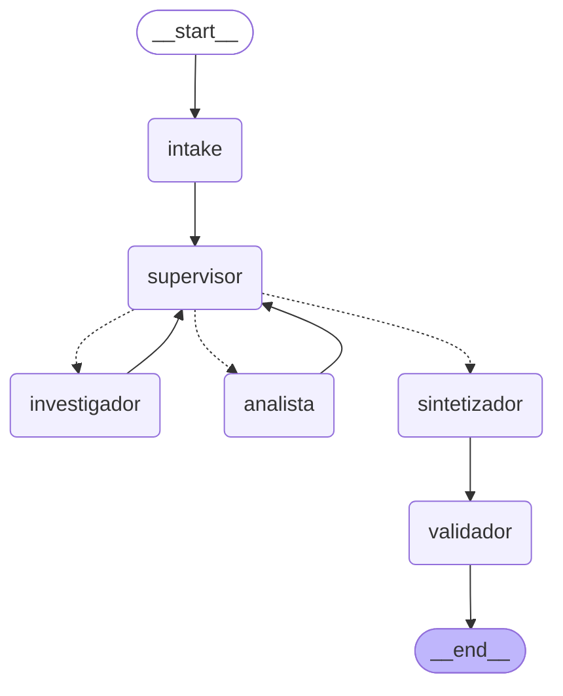

# Orquestador multi-agente — BA Explore AI (Pre-entrega 6)

Sistema multi-agente con **topología jerárquica** construido con LangGraph. Un **Supervisor** recibe una consulta turística sobre Buenos Aires, decide qué especialista debe intervenir, valida su trabajo con una rúbrica y recién entonces cierra con una síntesis validada.

> *"Armame un plan en Recoleta: museos y parrillas, a menos de 2 km. Quiero saber si conviene salir por el clima."*
> exige **dos dominios** distintos: investigar (OpenStreetMap, Open-Meteo) y analizar (ranking híbrido, recorrido, clima).

## Diagrama del grafo



Las líneas punteadas son las **aristas condicionales** del Supervisor (retorna `Command[Literal["investigador", "analista", "sintetizador"]]`). También se exporta como imagen: [`grafo.png`](grafo.png) / [`grafo.mmd`](grafo.mmd) con `python main.py --grafo`.

## Estructura del repositorio

| Archivo | Rol |
|---|---|
| `state.py` | Estado compartido (`OrquestadorState`, hereda de `MessagesState`) y contrato Pydantic `Lugar`. |
| `agents/supervisor.py` | Nodo Supervisor: prompt con rúbrica + reglas de seguridad deterministas. |
| `agents/research_agent.py` | **Agente de Investigación**: herramientas `buscar_lugares` (OpenStreetMap), `resumen_wikipedia_tool`, `pronostico_clima` (Open-Meteo). |
| `agents/analyst_agent.py` | **Agente de Análisis/Cómputo**: `rankear_lugares` (BM25 + embeddings E5 + RRF), `calcular_recorrido`, `evaluar_clima_plan`. |
| `agents/synthesizer.py` | Nodos `sintetizador` (redacta) y `validador` (verifica contra la evidencia antes de `END`). |
| `graph.py` | Definición del `StateGraph` y nodo `intake`. |
| `routing.py` | Router de intención por reglas (sin LLM): categorías, ubicación y radio. |
| `tools/` | Capa de datos (`geodata.py`) y cómputo (`analysis.py`). |
| `main.py` | Demo por consola, traza y exportación del diagrama. |
| `demo.ipynb` | Notebook ejecutado que demuestra el flujo de delegación. |
| `traza_ejecucion.json` | Traza real de una ejecución (decisiones, contribuciones, validación). |
| `tests/test_reglas.py` | 7 pruebas offline (sin Internet ni LLM). |

## Flujo de delegación (ejecución real)

```
intake → supervisor → investigador → supervisor → analista → supervisor → sintetizador → validador → END
```

1. **intake** (reglas, sin LLM): categorías = `turismo`, `gastronomia`; ubicación = Recoleta; radio = 2000 m.
2. **supervisor** — decisión 1: no hay datos → delega al **investigador** con una instrucción específica.
3. **investigador**: `buscar_lugares` ×2 (turismo y gastronomía) + `pronostico_clima`. Valida los resultados con Pydantic y los guarda en el estado.
4. **supervisor** — decisión 2: la rúbrica de cobertura se cumple → delega al **analista**.
5. **analista**: `rankear_lugares` ×2, `calcular_recorrido`, `evaluar_clima_plan`.
6. **supervisor** — decisión 3: cobertura y análisis completos → `FINISH`.
7. **sintetizador** → **validador** → respuesta final con lugares, URLs de OSM, recorrido y veredicto de clima.

La traza completa está en [`traza_ejecucion.json`](traza_ejecucion.json) y en [`demo.ipynb`](demo.ipynb).

## Por qué esta topología

- **Jerárquica (supervisor + especialistas) y no una cadena fija:** el supervisor puede enviar de vuelta a un especialista a refinar su trabajo, o saltear pasos innecesarios. Una cadena fija (investigar → analizar → responder) no puede reaccionar si, por ejemplo, una categoría vino vacía.
- **Dos especialistas con herramientas disjuntas:** el investigador solo *lee* fuentes externas; el analista solo *computa* sobre lo ya recuperado y no tiene acceso a Internet. Así nadie puede pisar el trabajo del otro y cada prompt es corto y enfocado.
- **Todo pasa por el supervisor:** los especialistas nunca se llaman entre sí; siempre devuelven el control (`investigador → supervisor`, `analista → supervisor`). Hay un único punto de decisión y de trazabilidad.
- **Router por reglas antes del LLM (`intake`):** lo que se puede decidir con reglas transparentes (categorías, barrio, radio) no gasta llamadas al modelo. El LLM decide solo lo que requiere juicio: quién trabaja y si el resultado alcanza.

## Estado compartido y contexto

`OrquestadorState` (ver [`state.py`](state.py)) tiene campos con **dueño** claro: `lugares`, `centro`, `clima` y `contexto_wiki` los escribe el investigador; `analisis` el analista; `next_agent`, `instruccion` y `pasos` el supervisor. `contribuciones` y `decisiones` se **acumulan** con el reducer `operator.add`, por lo que siempre se puede rastrear *qué agente aportó qué*, sin depender del historial de mensajes.

**Contaminación de contexto:** los especialistas no reciben el historial completo, solo la *instrucción específica* del supervisor más los datos que necesitan. El supervisor, a su vez, ve un resumen compacto del estado (conteos y contribuciones), no los datos crudos.

## Manejo de conflictos entre agentes y condiciones de parada

El LLM del supervisor propone, y **reglas deterministas** ([`aplicar_reglas_seguridad`](agents/supervisor.py)) disponen:

| Riesgo | Mecanismo |
|---|---|
| **Supervisor infinito** | Techo duro de 6 decisiones (`MAX_PASOS_SUPERVISOR`) y `recursion_limit=40`; al llegar, fuerza `FINISH`. |
| **Bucle de correcciones** | Cada especialista corre como máximo 2 veces (una inicial y un refinamiento). Agotado, no se lo vuelve a llamar. |
| **Analizar sin datos** | Si propone `analista` y no hay lugares, se redirige al investigador. |
| **Cerrar antes de tiempo** | Si propone `FINISH` y falta el trabajo mínimo de un especialista, se lo envía. |
| **Categoría vacía tras un reintento** | La rúbrica indica no insistir: se finaliza reconociendo la limitación (el validador la reporta). |
| **LLM del supervisor caído** | Se sigue con la lógica mínima determinista; el flujo no se rompe. |

Cada override queda registrado en `decisiones` (campos `propuesta_llm`, `destino`, `override`).

**Validación (rúbrica + nodo `validador`):** el supervisor aplica una rúbrica de 4 puntos (cobertura, análisis, calidad, suficiencia) antes de elegir `FINISH`. Además, el `sintetizador` **no escribe nombres, URLs ni distancias**: solo elige `id`s de lugares del ranking y redacta comentarios. El `validador` descarta cualquier `id` que no exista en la evidencia y arma el texto con los datos reales. Si el LLM no elige nada válido, usa un respaldo determinista (los 2 mejores de cada categoría).

## Cómo ejecutarlo

Requiere **Python 3.12+** y una `GOOGLE_API_KEY` gratuita ([aistudio.google.com/apikey](https://aistudio.google.com/apikey)). Las APIs de datos (OpenStreetMap, Wikipedia, Open-Meteo) no requieren clave.

```bash
python -m venv .venv
.venv\Scripts\activate            # Windows  (source .venv/bin/activate en Linux/macOS)
pip install -r requirements.txt

copy .env.example .env            # Windows  (cp en Linux/macOS); pegar GOOGLE_API_KEY

python tests/test_reglas.py       # pruebas offline (sin Internet ni LLM)
python main.py                    # demo con la consulta de ejemplo
python main.py "Bares en Palermo a 1 km"   # consulta propia
python main.py --grafo            # exporta grafo.mmd / grafo.png
```

Para abrir el notebook de demo: `pip install jupyter` y ejecutar `demo.ipynb` desde esta carpeta. La primera ejecución descarga el modelo de embeddings (`multilingual-e5-small`).

## Adaptaciones respecto del notebook original

- **MCP → funciones directas.** El notebook exponía las APIs mediante un servidor MCP (`stdio`). Aquí las mismas llamadas (Overpass, Nominatim, Wikipedia, Open-Meteo, con caché) son funciones Python usadas como `@tool`, lo que simplifica el repo sin cambiar los datos.
- **Un solo supervisor LLM** reemplaza al router de intención + ejecución paralela: ahora decide en turnos, puede refinar y valida antes de cerrar.
- **Sin Cross-Encoder:** el ranking usa BM25 + E5 + RRF; se omitió el reranker para mantener la instalación liviana.
- **LLM:** Gemini (`gemini-flash-lite-latest`) en lugar de Qwen vía Hugging Face; se cambia con `GEMINI_MODEL`.

## Limitaciones

- Los datos son de OpenStreetMap: los horarios, precios y disponibilidad **no están verificados**, y las distancias son en línea recta, no tiempos de viaje.
- La calidad del ranking depende de lo completas que estén las etiquetas de OSM (por ejemplo, no todos los restaurantes tienen el campo `cuisine`, por lo que buscar "parrillas" puede devolver otros restaurantes).
- Overpass es una API pública y puede saturarse; los resultados se cachean 24 h en `ba_cache/`.

## Seguridad

La API key se lee de `.env`, que está en `.gitignore` junto con `ba_cache/`. Solo se sube `.env.example`.
